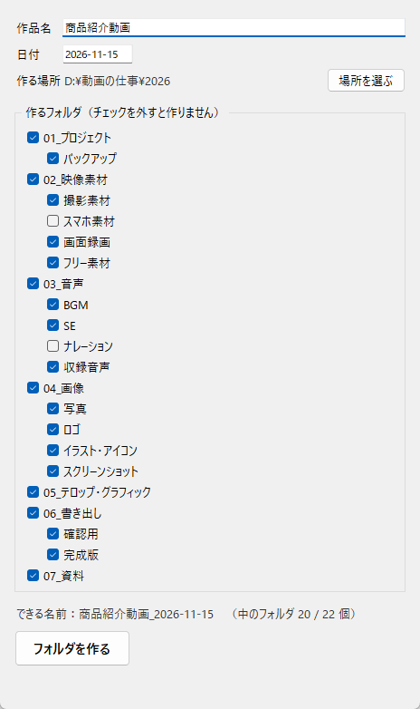

# Premiere フォルダテンプレート

動画編集を始めるときのフォルダを、ボタン1つでまとめて作るツールです。作品名と日付を入れると「作品名_2026-11-15」のフォルダができ、その中に素材・音声・画像・書き出しなどのフォルダが並びます。そのまま Premiere Pro のプロジェクトパネルにドラッグすると、同じ形のビン（Premiere の中のフォルダ）になります。



## できること
- 作品名・日付・作る場所を決めて、フォルダをまとめて作ります（最初の形では22個）
- 日付には、最初から今日が「2026-11-15」の形で入ります
- 作るフォルダは、チェックで ON・OFF できます。親を OFF にすると、その中も作りません
- 前回選んだ場所と、チェックの ON・OFF を覚えています
- フォルダの形は `template.txt` に書いてあり、メモ帳で書き換えるだけで変えられます

## 最初のフォルダの形

```
作品名_2026-11-15
├─ 01_プロジェクト ─ バックアップ
├─ 02_映像素材 ─ 撮影素材 / スマホ素材 / 画面録画 / フリー素材
├─ 03_音声 ─ BGM / SE / ナレーション / 収録音声
├─ 04_画像 ─ 写真 / ロゴ / イラスト・アイコン / スクリーンショット
├─ 05_テロップ・グラフィック
├─ 06_書き出し ─ 確認用 / 完成版
└─ 07_資料
```

## 工夫したところ
- **Premiere に合わせた見た目**：暗い画面に、Premiere のロゴに近い紫を差し色にしました。フォルダの一覧は2列に並べて、画面の縦を短くしています
- **形はプログラムの外に**：フォルダの形は `template.txt` に、空白2つの字下げで書きます。プログラムを直さなくても、自分の仕事に合わせて変えられます
- **書き間違いは行番号で知らせる**：タブでの字下げ、空白の数のずれ、同じ名前が2回、Windows で使えない文字や名前（`CON` など）があると、何行目がおかしいかを出して止まります
- **作れない入力ではボタンを押せない**：作品名が空・長すぎる、日付の形が違う、前回の場所が消えている、などのときは、理由を表示してボタンを押せないようにしました
- **失敗しても散らからない**：同じ名前のフォルダがあれば何も作らずに止まり、途中で失敗したときは作りかけの空フォルダを片付けます
- **実際に Premiere で確かめた**：作ったフォルダをプロジェクトパネルに入れると、空のフォルダもビンになり、中のフォルダもビンの中のビンとして並ぶことを確かめました

## 使い方
### 必要なもの
- Python 3（3.13 で確かめました）。追加の部品はいりません

### 起動

```
python app.py
```

### 画面なしで使う

```
python make_folders.py 作品名 作る場所 [--off 03_音声/ナレーション ...]
```

### exe にする（Windows）
[PyInstaller](https://pyinstaller.org/) を使うと、ダブルクリックで開ける exe にできます。

```
pip install pyinstaller
python -m PyInstaller --onefile --windowed --name premiere-folder-template --add-data "template.txt;." app.py
```

`dist` フォルダに `premiere-folder-template.exe` ができます。exe の隣に `template.txt` がなければ、最初の形で自動で作ります。

## ファイル
- `app.py`：画面（入力欄、チェックの一覧、作るボタン）
- `make_folders.py`：フォルダを作る部分（template.txt を読む、フォルダを作る）
- `template.txt`：作るフォルダの形
- `images/screenshot.png`：README の画面写真

## 使ったもの
- Python、tkinter、PyInstaller
- Claude：1ステップずつ一緒に作り、毎回動かして確かめました
